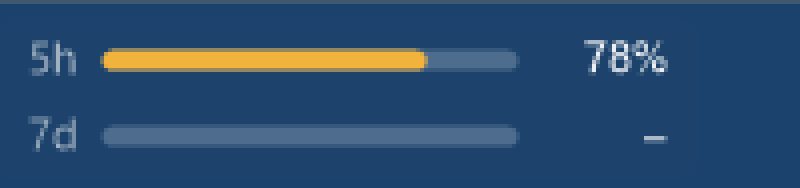

# SWCQ – Simple Widget Claude Quota

A tiny Windows taskbar widget that shows your Claude **5-hour** and **weekly (7-day)** usage at a glance.



*Enlarged 4×. Here is how it looks on the real taskbar:*


## Features

- Two bars on your taskbar: **5h** session usage and **7d** weekly usage, with percentages.
- **Drag it anywhere along the taskbar**: hold the left mouse button on the widget and move it where you like. The position is saved. Right-click → *Reset position* puts it back.
- Hover for a detail card with reset countdowns (and the weekly Opus/Sonnet limits when your plan has them).
- Right-click menu: *Refresh now*, *Update every* 1 / 5 / 10 minutes, *Start with Windows*, *Reset position*, *Exit*.
- A single small `.exe`, no installer, no runtime to download.

## Requirements

- Windows 10/11 (.NET Framework 4.x is already part of Windows).
- [Claude Code](https://claude.com/claude-code) installed and logged in with your Claude.ai account (run `claude`, then `/login`).

## Build & run

```bat
build.bat
```

This compiles `ClaudeQuotaWidget.cs` with the `csc.exe` that ships with Windows and starts `ClaudeQuotaWidget.exe`. Nothing to install.

## How it works

The widget reads the Claude Code login token from `%USERPROFILE%\.claude\.credentials.json` (or `%CLAUDE_CONFIG_DIR%\.credentials.json`) and calls the same usage endpoint that Claude Code's `/usage` command uses. It only **reads** the credentials file and never writes to it. Your token is sent only to `api.anthropic.com`.

Settings (refresh interval, position) are stored in `%APPDATA%\ClaudeQuotaWidget`.

> This is an unofficial community project. It is not affiliated with or endorsed by Anthropic. The usage endpoint is undocumented and may change.

## License

[MIT](LICENSE)
